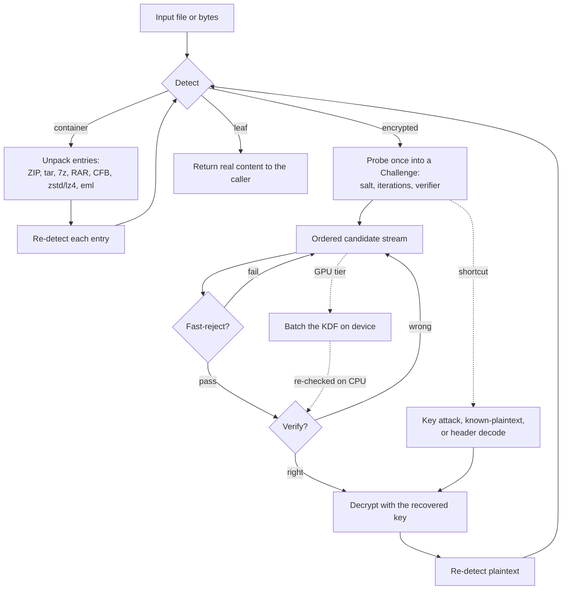

# Xcrack

**Xcrack recovers access to password-protected and encrypted files so their
contents can be inspected.** Its primary role is as an embeddable Go library
inside the **Impex** malicious-content scanner: when Impex meets an encrypted or
password-protected file, Xcrack decrypts it — and recursively unpacks any nested
layers — so the scanner can analyse the real content. It is delivered in three
forms over one engine:

- **Library** (`github.com/rom/xcrack/pkg/xcrack`) — what Impex embeds.
- **CLI** (`xcrack`) — triage, testing, manual recovery.
- **HTTP service** (`xcrackd`) — a backend a thin client (an Impex kiosk or
  DataLock appliance) calls, optionally fronting a separate GPU/OpenCL tier.

👉 **New here? Read [`docs/USAGE.md`](docs/USAGE.md)** for commands, flags, and
many worked examples.

> **Authorized use only.** Xcrack is a defensive / recovery tool, built to run
> against files you own or are explicitly authorized to access — malware-analysis
> pipelines, DFIR, sanctioned engagements, forgotten-password recovery. It
> performs **offline** guessing against a file's own key-derivation function; it
> never attacks remote systems, never executes or renders content, and ships no
> network/online attack modes.

## What it handles

| Family | Formats |
| ------ | ------- |
| **Archives** | ZIP (ZipCrypto, WinZip AES), tar, gzip, bzip2, xz, **zstd**, **lz4**, **7z**, **RAR** — 7z/RAR also **header-encrypted** (`-mhe` / `-hp`) |
| **MS Office** | OOXML (`.docx/.xlsx/.pptx`, agile + standard); legacy (`.doc/.xls/.ppt`: RC4 CryptoAPI, RC4 97-2000, XOR); **VBA project** macro password (`vba-recover` / `--as vbaproject`); **Office family** — encrypted Publisher/Visio/Project ride the shared OOXML path; **Access** — Jet (`.mdb`) password recovered from the header with no cracking (`access-recover`), ACE (`.accdb`) detected |
| **Other docs** | PDF (RC4 / AESV2 / AESV3, user + owner); ODF / LibreOffice (AES-256-CBC **and AES-256-GCM**); **Apple iWork** (Pages/Numbers/Keynote) |
| **Disk images** | Apple **encrypted DMG** (v2 AES-128/256) read on-disk directly, plus v1/v2 via the `dmg2john` `$dmg$` line |
| **Mail / passphrase** | MIME (`.eml`) attachments; **age** (scrypt); **symmetric OpenPGP** (`gpg -c`) |
| **Keys / key stores** | OpenSSH keys; PEM/PKCS#8; JKS; PKCS#12 (`.p12`); PuTTY `.ppk`; **SQLCipher** (`--as sqlcipher`); **KeePass** (`.kdbx` KDBX4, Argon2d/Argon2id/AES-KDF) |

Every scheme is cross-validated — against known-answer vectors, the real
`zip` / `qpdf` / `7z` / `rar` / `age` / `gpg` CLIs, and byte-for-byte against
gold-standard decrypted legacy-Office documents.

> New to the vocabulary (KDF, verifier, ZipCrypto, AE-1/AE-2, KPA, TMTO, …)? The
> **[glossary in `docs/TERMINOLOGY.md`](docs/TERMINOLOGY.md)** defines the engine
> concepts, cryptographic terms, formats, attacks, and abbreviations used here.

Recovery features: recursive decomposition of nested layers into a result tree
(password **and** content reported per layer), password promotion across layers
(and corpus-wide with `--adaptive`), a hashcat-compatible pattern engine (masks
+ rules + hybrid wordlist±mask + mask-increment), candidate generators
(combinator, PRINCE, toggle-case, keyboard-walk, Markov/PCFG, spray, breach
corpora), a built-in **Swedish** language list (`--swedish`) and Markov
likeliest-first ordering (`--order markov`), keyspace **sharding** across
machines (`--shard I/N`), a per-file `--time-limit` so a stuck file never
blocks a batch, two-axis globally-bounded concurrency, disk-streaming of large
entries, resource budgets + bomb defenses, and — to offload heavy cracking —
challenge export/import (`xcrack export-challenge` / `--resume-from`) plus
`$office$`/`$pdf$`/`$zip2$`/`$dmg$` hash-line emitters (`xcrack hashline`) for
hashcat / John the Ripper. **Distributed cracking** (`--server`,
`--cluster-mode collective|partition`) fans the search out across a fleet of
`xcrackd` workers; each server also has an optional, opt-in **built-in** OpenCL
tier (`-tags opencl`, `--gpu`) that batches the PBKDF2-HMAC-SHA1 sweep of the
live search onto the device.

## How it works

Xcrack detects each file **by content**, probes its encryption once, then tests
an ordered stream of candidate passwords against a cheap verifier — and recurses
into whatever it unpacks or decrypts, so a password-protected file nested inside
archives and documents is found and cracked automatically.



Candidates are tried highest-yield first: cached/promoted passwords and the
potfile → the built-in default list (empty password, `VelvetSweatshop`) → hints
and context → wordlists (± rules) → masks / hybrid / combinator → PRINCE /
Markov / PCFG generation. The **verifier** is always re-run on anything the
fast-reject or the GPU flags, so neither can cause a false positive.

## Quick start

Requires Go 1.25+ (a `go.work` ties the three modules together).

```sh
make build                    # -> bin/xcrack and bin/xcrackd
make check                    # gofmt check + vet + race tests (what CI runs)

# Decrypt + recursively decompose, writing the tree + manifest.json to ./out:
bin/xcrack -p infected -p Welcome1 -w rockyou.txt -o ./out invoice.zip

# Try it on the bundled samples (every passphrase is "opensesame"):
bin/xcrack -w samples/wordlist.txt samples/zipcrypto.zip samples/secret.pdf

# Detect format / encryption only:
bin/xcrack identify suspicious.bin

# Run the backend service:
bin/xcrackd -addr :8080 -max-procs 16
curl -s --data-binary @invoice.zip 'http://localhost:8080/v1/decrypt?password=infected'
```

Embedding (the Impex pattern) — see `xcrack/examples/impex-embed` and
[`docs/USAGE.md`](docs/USAGE.md#embedding-the-library):

```go
pool := xcrack.NewPool(xcrack.Options{Workers: 4, MaxProcs: 8})
res, _ := pool.Process(ctx, reader, size,
    candidates.Chain(candidates.Explicit(emailPasswords...), candidates.DefaultList()))
res.Root.Walk(func(n *xcrack.Node) { /* scan n.Content ... */ })
```

## Repository layout

Three independent Go modules, layered so each lower one is reusable on its own:

| Module | Import path | Purpose |
| ------ | ----------- | ------- |
| **Xcrypto** | `github.com/rom/xcrypto` | Crypto library + cracking engine: primitives, the concrete encryption schemes, candidate generation, the pattern engine, and the concurrent password search. Core schemes are stdlib-only; extended schemes may use `golang.org/x/crypto`. Knows nothing about file formats or recursion. |
| **Xfileformats** | `github.com/rom/xfileformats` | Policy-free file-format library: detect a format, parse containers (ZIP, CFB/OLE2), build an `xcrypto.Challenge`. Delegates all cryptography to Xcrypto. |
| **Xcrack** | `github.com/rom/xcrack` | The recovery engine (recursive decomposition, result tree, password promotion, budgets, pool), the `xcrack` CLI, and the `xcrackd` HTTP service. |

```
/
├─ Makefile                 build (-> bin/), test, race, vet, fmt, fuzz, …
├─ bin/                     compiled binaries land here (git-ignored)
├─ xcrypto/                 module github.com/rom/xcrypto   (crypto + cracking)
│    ├─ prim/               primitives: PBKDF2 · Argon2d/i/id · AES-CTR/CBC/ECB/GCM · RC4 · Office hash
│    ├─ scheme/…            zipcrypto · winzipaes · ooxml · pdf · odf · officebinary · age · pgp · keepass · …
│    ├─ hashline/           $office$/$pdf$ emitters for hashcat / John (GPU offload)
│    ├─ candidates/         candidate sources + Markov ordering
│    ├─ pattern/            hashcat-compatible masks + rules
│    └─ attack/             concurrent password-search engine
├─ xfileformats/            module github.com/rom/xfileformats  (parse + detect)
│    ├─ formats/{zip,ooxml,pdf,odf,msoffice,age,pgp,archive}
│    └─ internal/cfb        OLE2 / compound-file reader
├─ xcrack/                  module github.com/rom/xcrack
│    ├─ pkg/xcrack/         engine: recursion · tree · promotion · budgets · pool · metrics
│    ├─ pkg/api/            HTTP service wrapping the engine (Pool)
│    ├─ cmd/xcrack/         CLI
│    └─ cmd/xcrackd/        HTTP service (backend for kiosk / DataLock)
├─ samples/                 encrypted demo files (pw "opensesame") + generate.sh
├─ config/                  example --config YAML files (basic, mask-rules, hint, …)
└─ docs/                    usage, architecture, design, ASR, MVP, threat model, ADRs
```

## Documentation

- **[Usage](docs/USAGE.md)** — commands, flags, config, patterns, library, service — with many examples and end-to-end use cases.
- **[How Xcrack attacks each format](docs/CRACKING.md)** — per-format KDF/cipher/verifier, the attack used, and the verification shortcuts & cryptanalysis exploited (ZipCrypto key recovery, Office/PDF 40-bit key attacks, Access Jet header XOR).
- **[File formats & variants](docs/FILEFORMATS.md)** — every supported format, its variants, detection, verifier/KDF/cipher, and cross-validation oracle.
- **[FAQ](docs/FAQ.md)** — quick answers on formats, orchestration, methods, KDFs, ciphers, shortcuts, candidate ordering, cryptanalysis, output, config and CLI options.
- **[Terminology](docs/TERMINOLOGY.md)** — the glossary: engine concepts, KDFs, ciphers & modes, formats, attacks & shortcuts, and the abbreviations/TLAs used across the docs.
- **[References](docs/REFERENCES.md)** — the KDFs, ciphers, cryptanalysis, and candidate/attack methods used, with primary references.
- **[Changelog](docs/CHANGELOG.md)** — notable changes by pull request.
- [Architecture](docs/architecture.md) — system context, containers, components, data flow.
- [Design](docs/design.md) — public APIs, the recursion algorithm, the pattern engine, concurrency, error model.
- [ASR](docs/asr.md) — quality attributes and constraints that shape the architecture.
- [MVP](docs/mvp.md) · [Roadmap](docs/roadmap.md) · [Threat model](docs/threat-model.md) · [ADRs](docs/adr/).

Start with the docs index in [`docs/README.md`](docs/README.md).

## Status

Working end to end across all three modules; **MVP and Phase 2 complete**, with
the service tier and several Phase 3/4 engine features landed:

- **Formats** — the whole table above, each cross-validated (see
  [Roadmap](docs/roadmap.md) for the exact matrix).
- **Service tier** — `xcrackd` HTTP API (`/v1/identify`, `/v1/decrypt`,
  `/v1/metrics`, `/v1/healthz`); `Pool.Metrics()` telemetry; a pluggable live
  candidate provider.
- **Search** — statistical (Markov) candidate ordering; challenge export/import
  so heavy cracking can be offloaded to an external GPU/OpenCL engine. The
  default build stays pure Go and CPU-only; the opt-in `xcrackd` OpenCL tier
  (`-tags opencl`, `--gpu`) now feeds the **live crack loop** directly —
  acceleration-capable targets (WinZip-AES, encrypted DMG, and other
  PBKDF2-HMAC-SHA1 schemes) have their key-derivation sweep batched onto the
  device, with the CPU verifier re-checking every hit and handling everything
  the kernel can't.
- **Hardening** — fuzz targets on every hostile-input parser plus the whole
  pipeline, a decompression-bomb / fan-out / cycle corpus, `recover()` guards on
  every format call, and a GitHub Actions CI workflow (build · vet · gofmt ·
  `-race` · govulncheck · bounded fuzz).

Non-brute-force recoveries also ship: ZipCrypto known-plaintext **and**
cross-entry key recovery (`kp`), the Office 97/2000 and PDF V1/R2 **40-bit key
attacks** (`office-keyattack` / `pdf-keyattack`), the **MS Access Jet**
header-XOR decode (`access-recover`), and the **MS VBA project** password decode
(`vba-recover` — plaintext read directly, otherwise a salted-SHA-1 crack) — see
[`docs/CRACKING.md`](docs/CRACKING.md).

**Staged** (implemented as test fixtures / oracles become available): MS Access
**ACE** (`.accdb`) password *recovery* (detection ships now; Jet `.mdb` recovery
already ships) and legacy-Office macro/VBA auxiliary-stream decryption.

> **Legacy-Office scope.** RC4 CryptoAPI (Office XP/2003) is fully decrypted and
> cross-validated for Word, Excel, and PowerPoint. Office 97/2000 RC4 and XOR
> obfuscation are implemented and unit-tested; XOR *content* reconstruction is
> wired for Excel but not Word (no reference oracle), and only the main document
> streams are decrypted (auxiliary encrypted streams are left as-is).

## License

MIT (planned). See
[`docs/adr/0001-pure-go-no-external-binaries.md`](docs/adr/0001-pure-go-no-external-binaries.md)
and the [roadmap](docs/roadmap.md) for dependency and licensing posture.
