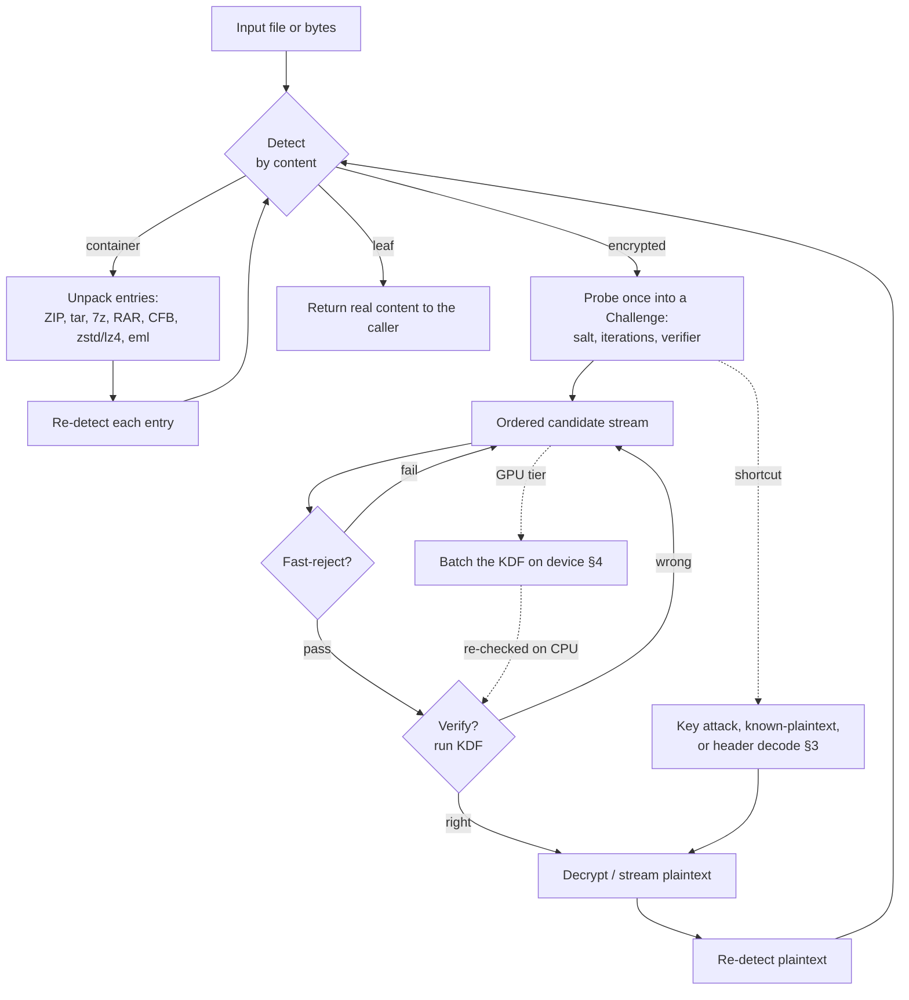

# How Xcrack attacks each format

This document explains, per supported file type, **how the password or key is
recovered** — the key-derivation function (KDF), the bulk cipher, the *verifier*
(the cheap check that tells a wrong guess from a right one), and which attack the
engine brings to bear. It also catalogues the **verification shortcuts and
cryptographic weaknesses** Xcrack exploits (or could), and which heavy steps the
optional GPU tier accelerates.

For the format **catalogue** (what is detected, parsed and decrypted, with
cross-validation notes) see [`FILEFORMATS.md`](FILEFORMATS.md). For the attack
**backlog** see [`roadmap-enhancements.md`](roadmap-enhancements.md).

> Authorized use only. Xcrack is a recovery/defensive tool: operate on files you
> own or are explicitly permitted to access.

---

## 1. The attack pipeline (all formats)

The engine probes a file's crypto once, then tests many candidates cheaply, and
re-detects whatever it unpacks or decrypts so nested layers are followed to the
real content. Candidates come from the ordered pipeline (highest-yield first):

1. **Cached / recovered passwords** — the found-password cache / potfile and
   ancestor passwords (promotion / `--adaptive`), plus `--loopback` re-mangles.
2. **Default list** — a small built-in common-password list; its first two
   entries are the **empty password** and **`VelvetSweatshop`** (see §3).
3. **Hints & context** — an embedded password hint (iWork `.iwph`, ZIP comment)
   and names / plaintext siblings (`--hint`, `--context`).
4. **Spray / breach / language lists**, then **wordlists** (± rules), then
   **masks / hybrid / combinator / PRINCE / Markov / PCFG** generation.

Every format carries a **cheap verifier** so a wrong guess is rejected without
decrypting the body, and most carry an even cheaper **fast-reject** (a 1–2 byte
check) tried before the KDF. The authoritative verifier is always re-run on a
candidate the fast path or an accelerator flags, so neither can cause a false
positive.

---

## 2. Per-format attack reference

Legend: **KDF** = how a password becomes a key · **verifier** = the pass/fail
check · **attack** = the primary recovery path.

### Archives

| Format | KDF / cipher | Verifier | Attack & shortcuts |
|--------|--------------|----------|--------------------|
| **ZIP — ZipCrypto** | bespoke 32-bit×3 key schedule; PKWARE stream cipher | 1 check byte (1/256), then CRC32 of the content | Dictionary/rules, **a password-free known-plaintext key recovery** (Biham–Kocher), **and cross-entry reuse** — one recovery decrypts the whole archive (`kp --zip`) — see §3. |
| **ZIP — WinZip-AES** (AE-1/2) | PBKDF2-HMAC-SHA1 ×1000; AES-CTR | 2-byte verifier, then HMAC-SHA1 | Dictionary/rules; the PBKDF2 step is GPU-accelerable. Per-entry salt ⇒ no cross-entry key reuse. |
| **7-Zip** (AES-256) | SHA-256 iterated; AES-256-CBC | none cheap — decrypt + CRC | Dictionary/rules; one archive password unlocks all entries. |
| **RAR5** (AES-256) | PBKDF2-HMAC-SHA256 (custom chain); | **8-byte PswCheck in the header — verify with no decrypt** | Dictionary/rules; the fast 8-byte check serves every entry and `-hp` headers. |
| **RAR4** (AES-128) | key schedule; AES-128-CBC | none by design — decrypt + CRC | Dictionary/rules. |

### Microsoft Office

| Format | KDF / cipher | Verifier | Attack & shortcuts |
|--------|--------------|----------|--------------------|
| **Office 97/2000 RC4** | `trunc = MD5(UTF16LE(pw))[:5]`; RC4 | MD5 EncryptionVerifier | Dictionary, **and a direct 40-bit key attack** (`office-keyattack`) — see §3. |
| **Office XP/2003 RC4 CryptoAPI** | SHA-1 → RC4 (per-block rekey) | SHA-1 EncryptionVerifier | Dictionary/rules only — the 160-bit `H0` leaves no 40-bit bottleneck, so no key attack. |
| **Office XOR obfuscation** | 16-byte XOR key array | 16-bit verifier | Passwords crack essentially instantly. |
| **OOXML agile** (2010+) | iterated SHA-1/256/384/512 ×~100k; AES-CBC | hash of a decrypted verifier block | Dictionary/rules; the spin loop is the GPU target. **VelvetSweatshop** for read-only-recommended workbooks (§3). |
| **OOXML standard** (2007) | SHA-1 ×50000; AES-128-ECB | hash of a decrypted verifier block | As above. |
| **VBA project password** | MS-OVBA "Data Encryption" obfuscation; `SHA1(pw‖4-byte salt)` (hashed form) | the stored 20-byte SHA-1 — or none (a plaintext password is stored directly) | `vba-recover` reads a plaintext password with **no cracking**; a hashed one is a fast salted-SHA-1 crack (`--as vbaproject`; John `dynamic_24` / hashcat `-m 110 --hex-salt`) — see §3. |

### Documents & media

| Format | KDF / cipher | Verifier | Attack & shortcuts |
|--------|--------------|----------|--------------------|
| **PDF** (RC4 V1–V2, AESV2, AESV3 R5/R6) | MD5 (R2–R4) / single SHA-256 (R5) / iterated SHA-2 "2.B" (R6) | `/U` (user) and, via `/O`, the owner password | Dictionary/rules on user **and** owner password; **owner/permission-only PDFs open with the empty password**; **a direct 40-bit file-key attack** on V1/R2 (and 40-bit R3/R4) RC4 (`pdf-keyattack`); R5's single-SHA-256 verifier is cheaper per guess than R6 — see §3. |
| **ODF** | PBKDF2-HMAC-SHA1; AES-256-CBC or -GCM | SHA-256 1K checksum (CBC) / GCM tag | Dictionary/rules; PBKDF2 GPU-accelerable. |
| **Apple iWork** | PBKDF2-HMAC-SHA1; AES-128 | `sha256(plain[:32]) == plain[32:64]` | Dictionary/rules; the embedded `.iwph` **hint** is tried first. |
| **Encrypted DMG** (v1/v2) | PBKDF2-HMAC-SHA1; 3DES-unwrap + AES-CBC | double-padding (v1) / 8 NUL bytes (v2) | Dictionary/rules; PBKDF2 GPU-accelerable (high iteration — a prime target). |

### Keys, credential stores & wallets (verify-only; the passphrase is the deliverable)

| Format | KDF | Verifier | Notes |
|--------|-----|----------|-------|
| **OpenSSH key** | bcrypt-pbkdf; AES-CTR | decrypt + key parse | Sound KDF; CPU-only. |
| **PEM / PKCS#8** | EVP_BytesToKey or PBES2 (PBKDF2/scrypt) | PKCS#7 padding + ASN.1 | Legacy MD5-KDF keys are weak/fast. |
| **JKS** | SHA-1(UTF16BE(pw) ‖ "Mighty Aphrodite" ‖ body) | trailing 20-byte digest | Pure-hash verify (no store decrypt). |
| **PKCS#12 (.p12/.pfx)** | RFC 7292 B.2 (SHA-1/256) | MacData HMAC | MAC-only verify, independent of bag encryption. |
| **PuTTY .ppk** | Argon2id/i (v3) or SHA-1 (v2) | Private-MAC | Argon2 is sound; CPU-only. |
| **SQLCipher** (v4/v3) | PBKDF2-HMAC-SHA512 ×256k / -SHA1 ×64k | page-1 HMAC | No AES decrypt to verify; SHA-512 PBKDF2 is GPU-accelerable. |
| **KeePass KDBX4** | Argon2d/id or AES-KDF | header HMAC-SHA256 | Argon2 is memory-hard; CPU-only. |
| **KeePass KDBX3.1** | AES-KDF (AES-256-ECB rounds) | stream-start bytes (AES-CBC) | AES-KDF is GPU-accelerable (shared seed). |
| **Ethereum keystore v3** | scrypt or PBKDF2-HMAC-SHA256 | Keccak-256 MAC | scrypt is memory-hard; PBKDF2 variant is GPU-accelerable. |
| **age (passphrase)** | scrypt; ChaCha20-Poly1305 | stanza AEAD tag | scrypt memory-hard; CPU-only. Public-key age needs a private key (out of scope). |
| **OpenPGP symmetric** (`gpg -c`) | S2K (iterated-salted) | 2-byte CFB quick-check, then SHA-1 MDC | S2K is a cheap iterated hash; GPU-accelerable (multi-block). |

### Data stores

| Format | Status |
|--------|--------|
| **MS Access — Jet** (.mdb, Access 97–2003) | Password recovered directly from the header XOR obfuscation — **no cracking** (`xcrack access-recover`), see §3. |
| **MS Access — ACE** (.accdb, Access 2007+) | Detection/identification only; the Office-style RC4/AES KDF has no shortcut, so a password search is the only route. |

---

## 3. Verification shortcuts & cryptanalysis

Xcrack prefers a shortcut over brute force wherever a real one exists. These
bypass or shrink the search:

### Already implemented

- **ZipCrypto known-plaintext key recovery (Biham–Kocher).** ZipCrypto is
  cryptographically broken: given ~12+ known plaintext bytes of any entry,
  `xcrack kp` (and the engine's per-entry `KeyRecover`) recover the 96-bit
  internal key state with **no password**, then optionally the password itself.
  Implemented in-tree (`xcrypto/scheme/zipcrypto`) with an external bkcrack
  offload (`--bkcrack`); results are CRC-re-validated, so a wrong known-plaintext
  cannot false-positive.
- **ZipCrypto cross-entry key reuse.** Every entry in a ZipCrypto archive shares
  one password and hence one pre-header key state, so a single recovery unlocks
  the whole archive. Once `xcrack kp --decrypt` has recovered that state (from a
  known-plaintext key recovery *or* a found password), `--zip ARCHIVE` seeds it
  into every other entry and decrypts them all with **no further search**
  (`--zip-out DIR` writes them out). Each entry is independently CRC-re-validated
  (`zip.DecryptArchiveWithStart`); AES and non-ZipCrypto entries are skipped.
- **Office 97/2000 40-bit RC4 key attack ("Thunder Tables").** The password
  enters only as `trunc = MD5(UTF16LE(pw))[:5]` — 40 bits — and the verifier and
  every block key derive from `trunc` and the salt alone. `xcrack office-keyattack`
  sweeps the 2^40 trunc space against the verifier and recovers the document key
  regardless of password length/complexity. Shardable and GPU-friendly. This is
  the attack hashcat documents in forum thread-3665 ("Colliding password
  protected MS office 97-2003 documents"): its collider mode `-m 9710` recovers
  the RC4 key to *open the document* with no real password (what `office-keyattack`
  does), while `-m 9720` would recover the actual password; the SHA1+RC4 CryptoAPI
  variant is the separate `-m 9800`, correctly out of scope for this key attack
  (see below).
- **PDF 40-bit RC4 key attack (V1/R2, and 40-bit R3/R4).** The PDF file key is a
  single MD5 truncated to 5 bytes — 40 bits — independent of the password's
  length, and the `/U` verifier, every per-object key and the whole document are
  functions of that file key alone. `xcrack pdf-keyattack` sweeps the 2^40
  file-key space against `/U` and recovers the key with no password, using only
  the public `/U`, `/ID` and revision (not `/O`, `/P`, or the password). The
  common R2 case runs an allocation-free inline-RC4 hot loop; shardable
  (`--shard i/N`) and parallel (`--workers`). 128-bit RC4 and the AES schemes
  (AESV2/AESV3) have no such bottleneck and the command declines them. Validated
  against a real 40-bit PDF produced by qpdf (`keyattack_test.go`).
- **PDF V1/R2 precomputed "Thunder Tables" (rainbow TMTO).** For R2, `/U =
  RC4(fileKey, pad)` where `pad` is the fixed 32-byte PDF padding — a salt- and
  ID-free function of the 40-bit key, so **one precomputed table inverts every
  V1/R2 document**. `xcrack thunder-gen` builds a rainbow time-memory trade-off
  (Oechslin 2003: column-indexed chains, multiple independent sub-tables for
  coverage, only chain endpoints stored), and `xcrack pdf-keyattack --table FILE`
  recovers the file key in **sub-second** instead of the ~week-of-CPU full sweep
  — the capability Elcomsoft markets as "Thunder Tables" for 40-bit Office. The
  one-time generation cost is ≈ the sweep (`thunder-gen --dry-run` estimates it)
  and `thunder-gen --gpu` offloads the chain walk to an OpenCL device (the
  `pdf_thunderchain` kernel, byte-identical to the CPU walk — §4); storage is the
  endpoints (tunable via chain length). Every lookup hit is
  re-checked against the real `/U` and `pdf.Handler.VerifyFileKey`, so a chain
  false-alarm is rejected and the table never yields a wrong key; a miss falls
  back to the live sweep. It does **not** apply to R3/R4 (whose `/U` hashes the
  per-file `/ID`) or to Office 97/2000 (per-file salt) — those stay on the sweep
  (`xcrypto/scheme/pdf/thundertable.go`, cross-validated in `thundertable_test.go`
  against `VerifyFileKey` and the live `RC4KeyAttack`).
- **PDF R5 (Acrobat 9 AESV3) single-round SHA-256 verifier.** Revision 5 — Adobe's
  deprecated pre-ISO AES-256 extension (Acrobat 9, 2008) — checks the password
  with a **single** SHA-256 of `password ‖ 8-byte validation salt` and no
  iteration, whereas R6 (ISO 32000-2, Acrobat X+) runs the iterated Algorithm 2.B
  (≥64 rounds of SHA-256/384/512 with an AES-CBC mix). Xcrack verifies R5 with
  exactly that one hash per candidate (`hash2B` short-circuits for `R < 6`), so an
  R5 dictionary runs at raw-hash speed — materially faster per guess than both R6
  and even the older 128-bit RC4 (R3/R4). This is the weakness Elcomsoft flags:
  Acrobat 9's "upgrade" to 256-bit AES actually made password guessing *faster*
  than the scheme it replaced, until ISO restored a proper multi-round hash in R6.
  There is no key-space shortcut (the key is a true 256-bit AES key, not a 40-bit
  RC4 key), but the per-candidate cost is minimal; R6 Xcrack implements separately
  and validates 300/300 against qpdf.
- **MS Access (Jet) header XOR.** Jet3/Jet4 store the database password
  XOR-obfuscated with fixed, public material — the header page is masked with a
  fixed 128-byte mask, and (Jet4 only) the password field is additionally masked
  with a 4-byte value folded from the creation date. `xcrack access-recover`
  reverses both and reads the password straight out of the header with **no
  cracking** (`xfileformats/formats/access.RecoverJetPassword`). ACE (.accdb,
  Access 2007+) uses a real Office-style KDF and is declined. Cross-validated
  against jackcess (an independent implementation that produced a known-password
  Jet4 fixture; `jet_test.go`), with the decoder fuzzed against hostile headers.
- **MS VBA project password (MS-OVBA).** The VBA IDE's "lock project for viewing"
  password is stored in the DPB field of the PROJECT stream, wrapped in the
  reversible, keyless MS-OVBA "Data Encryption" (section 2.4.3). `xcrack
  vba-recover` reverses it: a password stored in the clear is read out with **no
  cracking** (like the Access Jet decode), and a password stored as the 29-byte
  Password Hash Data Structure (2.4.4.1) yields a 4-byte salt and a 20-byte
  `SHA1(password‖salt)` (2.4.4.4) — a fast, salted-SHA-1 verifier (John
  `dynamic_24` / hashcat `-m 110 --hex-salt`) crackable in-engine with `xcrack
  --as vbaproject`. It works on legacy `.doc/.xls/.ppt`, a standalone
  `vbaProject.bin`, and macro-enabled OOXML (`.docm/.xlsm/.pptm`, whose
  `vbaProject.bin` part is unwrapped). The VBA source is never encrypted, so the
  password is the only deliverable. The Data-Encryption transform is round-trip
  tested and the salted-SHA-1 is cross-validated against an independent MS-OVBA +
  hashlib reference (`xcrypto/scheme/vbaproject`), including hashes/keys with
  embedded NUL bytes; parsers fuzzed.
- **VelvetSweatshop / empty password.** Excel "encrypts" a read-only-recommended
  workbook with the fixed key `VelvetSweatshop`; owner/permission-only PDFs and
  read-only Office documents open with the **empty** password. Both are the first
  two built-in default candidates, so these files unlock with zero real search.
  For PDF this is the full key derivation from the empty **user** password, so it
  covers *every* revision — including 128-bit RC4 (R3/R4) and AES (AESV2/AESV3),
  where the file key cannot be brute-forced: an owner-restricted PDF with no open
  password is decrypted (and its restrictions stripped) instantly, which is the
  only feasible route for those strong-crypto revisions.
- **Embedded hints.** The iWork `.iwph` hint and ZIP entry comments are parsed
  and tried first (`--hint`), and plaintext siblings that name the password are
  harvested (`--context`).
- **Fast verifiers.** RAR5's 8-byte header check, the ZipCrypto check byte, the
  WinZip-AES 2-byte value, and the OpenPGP 2-byte CFB quick-check reject most
  wrong guesses before the KDF runs.

### Known, real, and staged (documented, not yet implemented)

- **ZipCrypto weak-RNG "guaranteed recovery" (Stay 2001).** Legacy **WinZip ≤ 8.0**
  and **NetZip** generated the 12-byte encryption header that precedes every
  ZipCrypto entry with the Microsoft Visual C++ `rand()` PRNG, seeded from a value
  only **31 bits** wide. That tiny seed space can be swept directly, so when an
  archive holds **≥ 5 encrypted entries** the shared key state is recoverable with
  **no known plaintext at all** — a decryption that is "guaranteed" regardless of
  the password's length or complexity (Michael Stay, *ZIP Attacks with Reduced
  Known-Plaintext*, FSE 2001; productized in Elcomsoft AAPR as "guaranteed WinZip
  recovery"). It stays documented, not built: it applies only to a narrow tail of
  long-obsolete archivers, and the verify-first rule forbids shipping it without an
  oracle — no genuine WinZip ≤ 8.0 / NetZip archive is obtainable in this build
  environment to cross-validate the seed-recovery against. The common path (any
  ZipCrypto archive, any producer) is the already-shipped Biham–Kocher
  known-plaintext recovery with cross-entry reuse.
- **ZipCrypto reduced known-plaintext (Stay 2001).** The same paper cuts the
  Biham–Kocher plaintext requirement from ~12 bytes down to as little as **2–3
  bytes** in many cases. Xcrack does not implement the reduction because it buys
  little here: decryption needs the recovered *keys*, not the password, and ~12
  bytes of *compressed* plaintext (a known inner file, or a shared archive member)
  is nearly always available whenever any known plaintext is — so the full
  Biham–Kocher path (`xcrack kp`) already succeeds. Documented for completeness.
- **ZipCrypto password recovery from the recovered keys, in pure Go.** Once the
  Biham–Kocher attack has the three internal keys (which Xcrack already does),
  the original password can be recovered in ~n^(L−6) instead of n^L — the last
  ~6 bytes are pinned by the key-update recurrence, so only the first L−6 are
  searched (bkcrack `recoverpassword`). Xcrack already offers this through the
  bkcrack offload (`kp --recover-password`), and decryption itself needs only the
  keys (not the password), so a pure-Go reimplementation is a convenience, not a
  capability gain. It stays staged rather than shipped from incomplete knowledge:
  a subtly-wrong key-schedule inversion would violate the verify-first rule, so
  it would land only with full byte-for-byte cross-validation against bkcrack.

### Judged not worth it / not applicable (and why)

- **Office XP/2003 RC4 "CryptoAPI" 40-bit key attack.** A common misconception
  (hashcat even exposes "office key" modes for it) is that XP/2003's 40-bit RC4
  is key-attackable like Office 97/2000. It is **not**, for whole-document
  recovery. In the CryptoAPI scheme each block's RC4 key is
  `SHA1(SHA1(salt‖pw) ‖ LE32(block))[:5]`: the per-block keys all derive from the
  **160-bit** intermediate `H0 = SHA1(salt‖pw)`, which SHA-1 does not expose. A
  2^40 sweep can recover block 0's key (enough to clear the verifier and decrypt
  the first ≤512-byte block), but that key reveals nothing about `H0`, so blocks
  1..N — the rest of the document — cannot be derived. Office 97/2000 is
  different: there the real secret *is* the 40-bit `trunc`, and every block key
  is a function of `trunc`+salt, so the sweep recovers the whole document. The
  128-bit CryptoAPI variant ($4) is likewise out of reach. (Verified against this
  repo's own cross-validated CryptoAPI key derivation.)
- **Office 97–2003 RC4 keystream reuse (Wu, 2005; ePrint 2005/007).** Editing and
  re-saving an old-Office RC4 document under the same password reuses the salt,
  hence the keystream, so two versions form a two-time pad whose XOR cancels the
  keystream and leaks plaintext. Real, and the same spirit as the ZipCrypto
  cross-entry reuse — but it recovers *plaintext, not the password*, and needs
  two versions of the same file with the same password, a precondition rare
  enough that it is documented, not built.
- **JKS per-key keystream known-plaintext (Ettlinger).** Real, but it recovers
  the per-key *key-protection* password / the key itself, not the store integrity
  password Xcrack delivers (and the store and key passwords are usually identical
  anyway, so the recovered store password typically is the key password).
- **Weak-MAC / public-material cross-checks** (PKCS#12, PEM-with-certificate):
  no speedup — the existing verifiers already have a ~2^-32…2^-160 false-positive
  rate.
- **7-Zip, RAR4, WinZip-AES, OOXML agile/standard, SQLCipher, DMG, OpenSSH,
  PuTTY v3, Ethereum, age, OpenPGP:** surveyed, no structural shortcut — each is
  a deliberately slow KDF guarded by a strong verifier (the cheap fast-rejects
  that do exist are already used). The WinZip AE-1 plaintext-CRC32 leak
  (CVE-2026-44722) recovers only small/low-entropy *plaintext*, never the
  password, so it adds nothing over the existing HMAC/2-byte verifier.
- **Public-key age / PGP, full RAR4/7z verifiers:** no shortcut exists (need a
  private key, or the format stores no verifier by design).

---

## 4. What the GPU tier accelerates (and what it can't)

The opt-in OpenCL tier (`xcrackd --gpu`, `-tags opencl`) batches the one heavy,
embarrassingly-parallel step — the KDF — and leaves verification on the CPU. It
ships **PBKDF2-HMAC-SHA1 / -SHA256 / -SHA512** kernels plus the **Office
agile/standard iterated-hash spin** (SHA-1/256/384/512), each byte-for-byte
self-tested against the Go reference before use.

**Accelerated formats:** WinZip-AES and encrypted DMG (PBKDF2-SHA-1), **ODF**
(PBKDF2-SHA-1, with the start-key hash applied per-candidate via
`AccelKDF.PreHash`), **RAR5** (PBKDF2-SHA-256 — its 8-byte password-check value
is a fold of PBKDF2-HMAC-SHA256(pw, salt, 2^Lg2Count+32, 32), so the batch kernel
serves it directly), and **Office 2010+ agile OOXML** (the ~100k iterated-hash
spin — the dominant cost of every modern Office document). The agile spin is a
dedicated kernel, not PBKDF2: the CPU does the one variable-length first hash
`H(salt‖UTF16LE(pw))` per candidate and the device runs the fixed-size loop
`cur = H(LE32(i)‖cur)`, with `Finish` re-running the authoritative verifier on
the derived digest (`AccelKDF.Office`). **SQLCipher is intentionally not
accelerated:** its v3/v4 profile cannot be told apart before a password
verifies, and the seam derives one profile per candidate, so offloading could
sweep the keyspace against the wrong profile and miss the real one — it stays on
the CPU where both profiles are tried.

The GPU also accelerates two **key-search** attacks (a different kernel shape from
the per-password batch above): the **Office 97/2000 2^40 MD5+RC4 trunc sweep**
(`xcrack office-keyattack --gpu`). The `oldoffice_md5rc4` kernel reproduces the
CPU verifier for every trunc index — `trunc2 = MD5(16×(trunc‖salt))[:5]`,
`key = MD5(trunc2‖LE32(0))[:16]`, `RC4` over the 32-byte verifier, `MD5` check —
one work-item per index, and publishes any hit via an atomic. The CPU re-checks
the hit (`officebinary.VerifyRC4Trunc`), so the device never decides correctness;
in a pure-Go build or with no device it falls back to the CPU sweep. The kernel
is validated against the CPU reference `officebinary.RC4KeyAttack` on pocl
(`OldOfficeKeySearcher`, `GPUSelfTest`).

The second is the **PDF Standard Security Handler 2^40 RC4 file-key sweep**
(`xcrack pdf-keyattack --gpu`), for V1/R2 and 40-bit R3/R4 documents. The file
key is `MD5(…)[:5]` and the `/U` verifier is a function of that 5-byte key alone,
so the `pdf_rc4keysearch` kernel is **RC4-only**: the one per-document MD5 the
R3/R4 path needs (`MD5(pad‖ID)`) is constant across keys and is precomputed on
the host, then each work-item RC4s the input `rounds` times (round `r` keyed by
`key5 XOR r` — R2: 1 round over the 32-byte pad; R3/R4: 20 rounds over the 16-byte
seed) and compares to `/U`. It reuses the same MD5+RC4 cores and the same hit/
atomic plumbing as the Office sweep. The CPU re-checks every hit
(`pdf.Handler.VerifyFileKey`) and the whole thing falls back to the CPU
(`pdf.Handler.RC4KeyAttack`) in a pure-Go build or with no device; validated
against the CPU reference on pocl (`PDFRC4KeySearcher`, `GPUSelfTest`).

Finally, the **VBA project salted-SHA-1** verifier is accelerated as a per-
password batch (not a key-search): `PasswordHash = SHA1(password‖salt)` with a
4-byte salt is hashcat's `sha1($pass.$salt)` (mode 110). The `vba_sha1` kernel
hashes a whole candidate batch at once; because the hash is a single un-iterated
SHA-1, this is cheap per candidate, so the device's job is bulk throughput and
the `Finish` closure trusts only a device *non-match* (a byte compare), re-hashing
on the CPU (`vbaproject.Verify`) for an apparent hit — the device never decides
correctness. It offloads through the live crack loop on the OpenCL server tier
(`xcrackd --gpu`) via a new `AccelKDF.SaltedSHA1` seam, the same path the PBKDF2
and Office-spin batches use, and falls back to the per-candidate CPU hash when no
device is built/available. Validated against `crypto/sha1` on pocl
(`SaltedSHA1Hasher`, `GPUSelfTest`).

The GPU also accelerates **thunder-table generation** — not a crack itself but
the heavy one-time precompute behind the PDF V1/R2 TMTO (§3). `thunder-gen --gpu`
runs the `pdf_thunderchain` kernel with one work-item per rainbow chain, each
walking `chainLen` columns of `(RC4(k, pad)[:8] + seed + col) mod 2^bits`. It is
byte-identical to the pure-Go walk (so a GPU-built table is inverted by the same
CPU lookup — cross-validated GPU-vs-CPU byte-for-byte), via the
`accel.PDFThunderChainer` capability and the `pdf.ChainComputer` seam, with a
per-sub-table CPU fallback on any device error.

**Good candidates for additional kernels** (catalogued from a survey of the
schemes):

| Candidate | Benefits | Difficulty |
|-----------|----------|------------|
| **Office standard iterated hash** (SHA-1 ×50000) | Office 2007 | the spin kernel already exists (shared with agile); only the standard `Finish` wiring (the post-spin `H(cur‖0)` + 0x36/0x5c derive) remains |
| **KeePass AES-KDF** (KDBX3 / KDBX4 AES) | KeePass AES-KDF files | moderate; needs an AES-256 core; the seed is shared across candidates |

(The **Office 97/2000 2^40 MD5+RC4 trunc sweep** and the **PDF R2–R4 2^40 RC4
file-key sweep** have both shipped — see the two key-search paragraphs above.)

**Deliberately CPU-only / out of scope for a kernel:** Argon2 (KeePass/PuTTY) and
scrypt (Ethereum/age/PBES2) are **memory-hard** — each work-item needs its whole
memory region, so a GPU runs only a few hundred concurrent instances; bcrypt
(OpenSSH) is Blowfish-based and GPU-hostile; and the ZipCrypto Biham–Kocher search
is branch-divergent cryptanalysis best served by the existing external bkcrack
offload.

Native **ROCm/HIP** (AMD) and CUDA back-ends are a documented future; because the
kernels are vendor-neutral OpenCL C, AMD GPUs and Ryzen APUs already run them
through the OpenCL ICD, and the tier auto-selects the best device across vendors
(see [`roadmap-enhancements.md`](roadmap-enhancements.md) §3).
